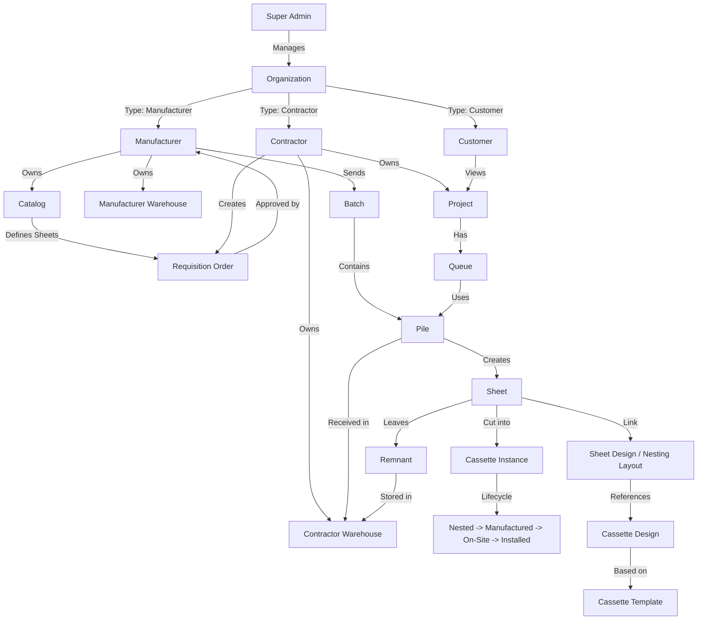

# SYSTEM: Cutkit-Demo

Cutkit-Demo is a professional DXF nesting application for CNC manufacturing. It allows users to upload parametric cassette templates, organize them into production batches, and run nesting algorithms to generate optimal material layouts, G-code, and PDF reports.

## Tech Stack
- **Frontend:** Nuxt.js 3 (SSR), Vue 3, PrimeVue, Tailwind CSS
- **Backend:** Nuxt Nitro (Node.js), MongoDB (native driver), GridFS for file storage
- **Workers:** Python-based workers for DXF processing and nesting (using jagua-rs)
- **Deployment:** Docker & Docker Stack

## Core Architecture
The system follows a modular architecture with a clean separation between the API/Frontend (Nuxt) and the processing units (Workers).

### Data Model (v24 Absolute Definitive)
See [server/DATA_MODEL.md](./server/DATA_MODEL.md) for the procedurally generated, up-to-date schema reference.

The system uses a standardized block-based architecture for all entities:
- **`identity`**: Unified slug, name, and serial/reference fields.
- **`origin`**: Immutable snapshot of the creation state.
- **`status`**: Current state snapshot with metadata and history links.
- **`lineage`**: Flat, cumulative ancestry trace for O(1) reverse lookups.
- **`specs`**: Standardized physical DNA (thickness, dimensions, area).

## v24 Core Patterns
1. **Cumulative Lineage**: Every child inherits its parent's lineage object and adds the parent's ID.
   - `child.lineage = { ...parent.lineage, projectId: id }`
2. **Declarative State Machines**: Entity lifecycles are governed by machines defined in `server/core/machines/`.
3. **Traceability Bridge**: Physical units (`sheets`, `instances`) link to both digital ancestry (`queueId`, `runId`) and physical ancestry (`pileId`, `warehouseId`).

### Containers
- **Web App (Nuxt):** Handles UI, user management, and business logic orchestration via standardized blocks.
- **Nesting Worker:** Python service that processes `nesting_runs` and generates `sheet_designs`.
- **MongoDB:** Primary data store utilizing lineage-based indexing for multi-tenant isolation.

## Key Workflows
1. **Traceable Production:** From `Project` -> `Queue` -> `Nesting Run` -> `Sheet Design` -> `Physical Sheet` -> `Cassette Instance`.
2. **Material Lifecycle:** From `Catalog` -> `Requisition` -> `Material Pile` -> `Individual Sheet`.
3. **State Management:** All status changes are validated by the State Machine Engine and logged to `status_events`.

## Components List
See details in sub-directories:
- [server/features](./server/features/NEOLIT.md) - Core business logic modules.
- [workers](./workers/NEOLIT.md) - Specialized processing units.
- [composables](./composables/NEOLIT.md) - Frontend state management.

## Deployment & Ops
See [DEPLOYMENT.md](./docs/DEPLOYMENT.md) for Docker stack setup, environment configuration, and monitoring strategies.
