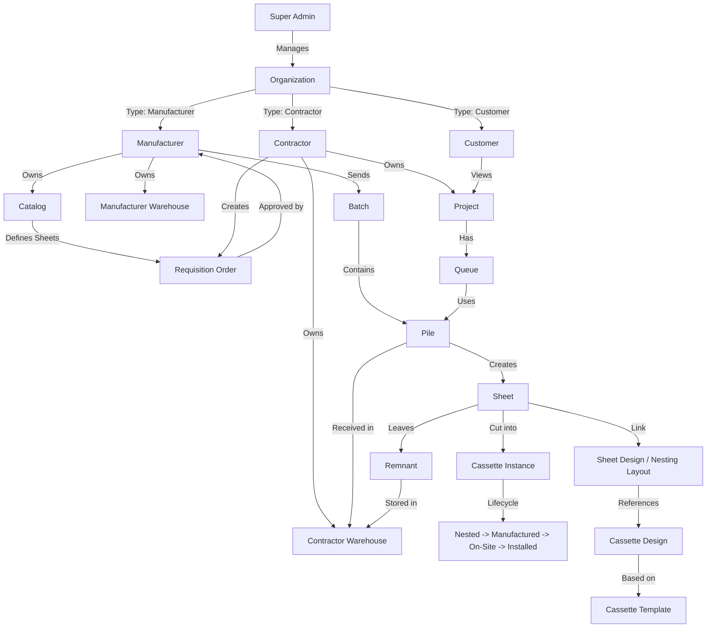

# 🛠️ Proper UI Rework & System Architecture Plan

## 1. System Architecture Diagram

## 2. Core UI Principles (Updated)
- **PrimeVue Defaults:** Use standard PrimeVue 4 components out-of-the-box. Avoid deep `pt:` overrides or custom Tailwind complex classes unless structural.
- **Minimal CSS:** Zero custom SCSS/CSS blocks in components. Rely on the global `Re_L` preset for all styling.
- **State Management:** Use existing Pinia store patterns (`stores/auth.js`, `stores/global.js`). Avoid introducing new complex reactivity patterns if existing ones suffice.

## 3. Global User Roles & Dashboards

| Role | Access Level | Primary Dashboard Elements | Main Navigation |
| :--- | :--- | :--- | :--- |
| **Super Admin** | System-wide | Org health, Total usage, Active Users | Organizations, System Users, Global Settings |
| **Manufacturer Admin** | Org-wide | Pending Requisitions, Catalog performance, Batch fulfillment status | Materials (Catalogs, Requisitions, Warehouses, Batches), Team |
| **Contractor Admin** | Org-wide | Project deadlines, Material stock alerts, Requisition status | Projects, Materials (Warehouses, Requisitions, Remnants), Assets (Templates, Tools), Billing, Team |
| **Customer Admin** | Org-wide | Project progress, Delivery timelines | Projects (Read-only), Profile |

## 4. Implementation Roadmap

### Phase 1: Foundation & Navigation
- [ ] **Auth Store Sync:** Ensure role-based computed flags in `stores/auth.js` accurately drive UI visibility.
- [ ] **Unified Layout:** Refactor `layouts/app.vue` navigation to use simple Hub-based grouping (Projects, Materials, Assets).
- [ ] **Permissions:** Apply standard `v-if="authStore.hasPermission(...)"` guards.

### Phase 2: Materials Hub (Dynamic Tabs)
- [ ] **Polymorphic Tabs:** Use `TabView` in `pages/materials/index.vue` to show appropriate features per role.
- [ ] **Requisition Loop:** Implement standard Table/Dialog interactions for Orders.
- [ ] **Warehouse Tracking:** Simple list/grid views of Piles and Remnants.

### Phase 3: Production Flow
- [ ] **Queue Management:** Transition "Batch" UI terminology to "Queue".
- [ ] **Instantiation UI:** Simple status updates for Cassette Instances.

### Phase 4: Team Management
- [ ] **Member Lists:** Standard Datatables for managing organization users.