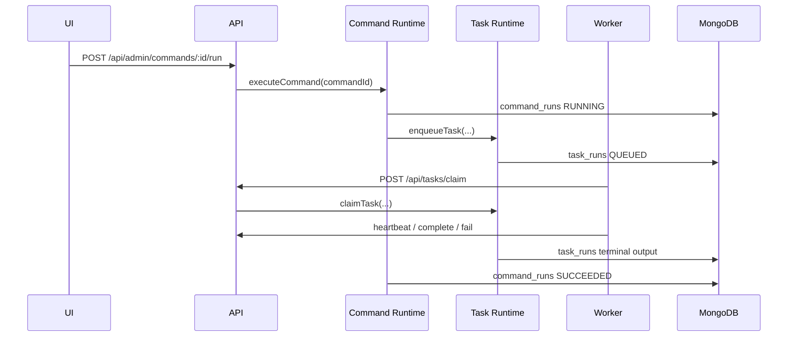

# SYSTEM: Perigram Demo

```yaml
doc_id: PERIGRAM-README-001
classification: reference
status: active
owner: product-owner
created: 2018-06-10
updated: 2026-09-30
```


Perigram is a process programming platform: organizations author typed
declarations, the process compiler turns them into runtime contracts, and
generic instance services run every declared type. This repository is the
demo deployment of that platform — a Nuxt/Nitro modular monolith backed by
MongoDB and worker services, carrying a facade fabrication domain pack as
its exercised example.

## Architecture

Domain vocabulary is authored, not hardcoded: packs and organizations
declare CTS types, the process compiler turns process graphs into runtime
contracts, and generic per-class instance services execute every declared
type (see [docs/SYSTEM_ARCHITECTURE.md](./docs/SYSTEM_ARCHITECTURE.md)).


## Vocabulary

| Term | Definition |
|---|---|
| Instance | Persisted object of a declared type, served by the generic per-class instance services; carries a flat wire `state` string when its type's producer workflow declares a vocabulary. The `entity` vocabulary is legacy and lives only in uncleated server contracts. |
| Command | Synchronous business intent and access boundary, recorded in `command_runs`. |
| Task | Async execution boundary, queued in `task_runs` and claimed by workers/executors. |
| Workflow | Entity lifecycle state machine and transition contract. |
| Hook | Workflow transition side-effect contract and registered handler. |
| Attachment | Persisted file/blob metadata linked to an entity. |
| AttachmentKind | Declared file content/preview/storage contract. |
| Adapter | App binding between pure domain definitions and infrastructure. |
| Process Definition | Organization-owned graph that maps organization roles to entity workflows, field policy, services, sockets, screens, and navigation runtime contracts. Role identity and user assignment remain organization data. |

Commands and tasks are not duplicates: commands decide "what business action is
allowed and requested"; tasks execute retryable background work created by those
commands.

## Containers

| Container | Source | Responsibility |
|---|---|---|
| `perigram-app` | `server/`, `pages/`, `components/`, `composables/` | Nuxt UI, Nitro API, command/task runtimes, feature services. |
| `nesting-worker` | `workers/nesting/` | FastAPI HTTP solver for nesting geometry. |
| `mongo` | Docker image | MongoDB documents and GridFS files. |
| `livekit` | Docker image (`livekit/livekit-server`, `livekit.dev.yaml`) | Self-hosted WebRTC SFU for voice/video calls; rooms are derived and token-gated by the `livekit` capability module. Call recordings ride an external egress plane (LiveKit + Redis + `livekit/egress` + an S3-compatible bucket) deployed beside whichever server the app targets. |

## Workflows



## Development

```bash
npm install
npx vitest run shared/framework-packages.spec.js shared/design-system.spec.js
npx vitest run --config vitest.ssr.config.js
node scripts/check-arch.js
npm run framework:validate
E2E_BASE_URL=http://localhost:3000 npm run test:e2e
```

The `vitest.ssr.config.js` run mounts real pages through
`vue/server-renderer` with Nuxt globals stubbed (see
[`test-tools/`](./test-tools/README.md)) — it guards against template
bindings that script-only checks cannot see.

Do not run `npm run build` or start dev servers from coding-agent tasks unless a
human explicitly asks. Worker endpoints require matching `WORKER_TOKEN` on app
and workers; compose files use `perigram-dev-worker` for local development.

The CutKit → Perigram rename changed default Mongo database names
(`cutkit_dev` → `perigram_dev`): copy or reseed local databases, and run
`node server/scripts/migrate-cutkit-extensions-to-perigram.js` once to
rename persisted `extensions.cutkit` authoring keys to `extensions.perigram`.
Docker dev starts Nuxt with `--host 0.0.0.0` so the app binds to the container
interface and is reachable through the compose `3000:3000` port mapping.
When opening the dev app from another device on the LAN, also set
`NUXT_DEV_HMR_HOST=<your-laptop-LAN-IP>` so the proxied Vite client advertises
the same browser-visible host for hot-module websocket traffic instead of an
internal container-only endpoint. `NUXT_DEV_HMR_CLIENT_PORT` defaults to
`3000`, and `NUXT_DEV_HMR_PROTOCOL` defaults to `ws`.
The E2E command assumes the app stack is already running and uses Playwright
against the configured `E2E_BASE_URL`.
Dev-stack filesystem runbook (compose mounts the repo at `/src`):
- Global stylesheets ride `plugins/global-styles.js`, not the Nuxt `css:`
  array: with Nuxt 3.19's vite builder, css-array entries land only in the
  SSR `entry-styles` sidecar, so production browsers never received
  tailwind/primeicons/main.css/the PrimeVue theme (2026-09-29 staging —
  "another css" broken layouts; dev and scoped styles were unaffected).

- `node_modules` is an anonymous container volume (`/src/node_modules`):
  host-side installs never reach the running container. To refresh
  dependencies, reinstall inside the container
  (`docker compose -f docker-compose.dev.yml run --rm app npm install`) or
  recreate the stack so the volume rebuilds.
- The container writes `.nuxt` as root. Host-side tooling that needs it
  (the SSR smoke's `.nuxt/tsconfig.json`, `npx nuxi prepare` in agent
  worktrees) fails on root-owned files — fix ownership once with
  `sudo chown -R "$(id -u):$(id -g)" .nuxt` (fresh worktrees instead run
  `npx nuxi prepare`, which regenerates their own).
- The compose stack declares `perigram-network` as an external bridge. Stacks
  started before the CutKit→Perigram rename still sit on the legacy
  `cutkit-network`, so any compose-driven change (an env update needs a
  container recreate) fails with "network declared as external, but could not
  be found". Create the network once (`docker network create
  perigram-network`) and run `docker compose -f docker-compose.dev.yml up -d
  app` to migrate the services onto it; mongo keeps its named volume across
  the recreate.
Agent session worktrees are nested under `.agent-worktrees/` (plus scratch
dirs `.agent-wt*`) in the project root. Nuxt scanning and the dev watchers
ignore that tree via a path predicate in `nuxt.config.js`: chokidar v4
leaks glob-ignored nested file events, and worktree `tsconfig.json`
checkouts would otherwise trip Vite's tsconfig reload loop and stall the
vite-node SSR module bridge past its request timeout. The per-environment
`vite.environments.*` watcher ignores are attached only in development —
a user-level `environments` object in a production build deroutes the
vite 7 SSR build output, and nitro fails with `Could not load
.nuxt/dist/server/server.mjs`. Run a production build when touching this
config; dev and the guards do not exercise the SSR bundle emit.
Server-side `xlsx` imports target the package's ESM build
(`import … from 'xlsx/xlsx.mjs'`): the CJS main carries an
`export `-leading prose comment that nitro's import-validity check
misreads as ESM syntax, so nitro refuses to externalize the package and
rollup bundles it instead — the CJS interop then demands a default
export from the externalized `node:fs` and every nitro server-bundle
rebuild fails with `"default" is not exported by "…node:fs?
commonjs-external"` (first hit 2026-09-29, when the facade order process
added the first server-side xlsx import). A `nitro.alias` rewrite is NOT
the fix: rollup's alias matches prefixes, so an aliased
`xlsx → xlsx/xlsx.mjs` re-matches itself and resolves
`xlsx/xlsx.mjs/xlsx.mjs` (ENOENT).

## Progressive Web App

The app is an installable, offline-capable PWA with a hand-rolled service
worker (`public/sw.js`, registered by `plugins/pwa.client.js` in production
builds only).

- Static decoration — fonts, icons, the favicon set, the manifest — is
  cached cache-first; only successful (`response.ok`, same-origin)
  responses are ever cached — error bodies and `206 Partial Content`
  range responses (browser media playback against `GET /api/**`) must
  not enter a cache: the Cache API rejects partials, and a partial body
  keyed to the full request would poison the offline fallback. Bumping
  the worker's cache version purges every client cache on activate.
- Everything the app needs to load and read offline — HTML navigations,
  `/_nuxt/` app chunks, and `GET /api/**` reads — is cached network-first:
  online loads stay fresh from the network, offline loads fall back to the
  last successful response, and a navigation that misses the cache
  entirely falls back to the cached root shell. The `/api/connections`
  SSE stream is never intercepted or cached. (`/_nuxt/` was once excluded
  from caching entirely — that concern targets cache-first staleness;
  network-first serves fresh code whenever the network is reachable, so
  the hashed chunk names make the offline copy safe. Dev is unaffected:
  no worker is registered there at all.)
- Dev loads self-heal the origin: every dev page load unregisters all
  service-worker registrations and deletes their caches, so a worker left
  by an earlier production build cannot keep serving stale code; only
  production builds register `/sw.js`.
- Offline mutations are queued in a client-side IndexedDB outbox
  (`utils/outbox.js`, `stores/outbox.js`) and replayed through the same API
  endpoints when connectivity returns. Entity CRUD (`useEntity`), status
  transitions (`useStateController`), and generated process actions route
  through the outbox; queued operations raise a typed `OfflineQueuedError`,
  and the floating `OfflineOutboxBadge` shows sync state with per-operation
  retry/discard. Successful replays emit the shared entity-event contract, so
  open screens reconcile as if the mutation happened locally.
- Replayed mutations carry an `Idempotency-Key` header deduped by
  `server/core/idempotency` (see
  [its README](./server/core/idempotency/README.md) for the contract).
- Realtime features (connections SSE, LiveKit calls, live chat updates) and
  file uploads remain online-only.
- `public/icon.svg` stays the favicon/install-icon source of truth; the
  rasterized set in `public/favicon/` is generated from it (Inkscape exports
  at 16/32/48/180/192/512; `favicon.ico` packs 16/32/48). Regenerate all sizes
  when the SVG changes instead of editing PNGs by hand.
- The production image mirrors `.output/public` into
  `.output/server/chunks/public` (Dockerfile): the Nuxt 3.19.3 nitro runtime
  resolves inline public assets against the server chunk directory, and
  without the mirror every static asset request 500s.

## Documentation Map

| Area | Doc |
|---|---|
| System graph | [docs/SYSTEM_ARCHITECTURE.md](./docs/SYSTEM_ARCHITECTURE.md) |
| Platform convergence roadmap | [docs/PLATFORM_CONVERGENCE.md](./docs/PLATFORM_CONVERGENCE.md) |
| Remote access and deployment | [docs/REMOTE_ACCESS.md](./docs/REMOTE_ACCESS.md) |
| UI component audit | [docs/UI_COMPONENT_AUDIT.md](./docs/UI_COMPONENT_AUDIT.md) |
| Backend | [server/README.md](./server/README.md) |
| Runtime registry | [server/runtime/README.md](./server/runtime/README.md) |
| Commands | [server/core/commands/README.md](./server/core/commands/README.md) |
| Tasks | [server/core/tasks/README.md](./server/core/tasks/README.md) |
| Domain package | [packages/facade/README.md](./packages/facade/README.md) |
| Type system (CTS) | [packages/cts/README.md](./packages/cts/README.md) |
| Process compiler | [packages/processes/README.md](./packages/processes/README.md) |
| Core package | [packages/core/README.md](./packages/core/README.md) |
| Pages and public entry | [pages/README.md](./pages/README.md) |
| Workers | [workers/README.md](./workers/README.md) |
| E2E workflow tests | [e2e/README.md](./e2e/README.md) |
| Scripts and guardrails | [scripts/README.md](./scripts/README.md) |
| Deploy tooling (Forgejo autodeploy) | [deploy/README.md](./deploy/README.md) |
| Facade explainer video | [video/README.md](./video/README.md) |
| Schema specs | [docs/specs/README.md](./docs/specs/README.md) |
| Plugin authoring guide | [docs/PLUGIN_AUTHORING.md](./docs/PLUGIN_AUTHORING.md) |
| Animated brand mark (Rive) | [assets/rive/perigram-mark/README.md](./assets/rive/perigram-mark/README.md) |
| Codex agent assets | [.codex/README.md](./.codex/README.md) |
