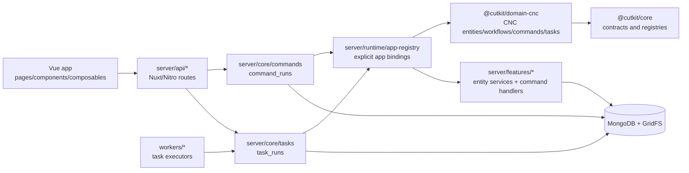
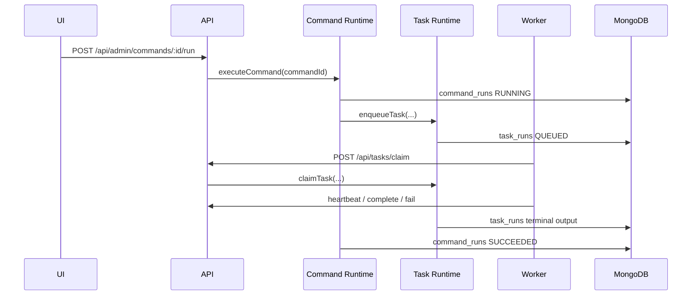

# SYSTEM: CutKit Demo

Multi-tenant CNC manufacturing app and framework extraction sandbox. The app is
a Nuxt/Nitro modular monolith backed by MongoDB and worker services.

## Architecture



## Vocabulary

| Term | Definition |
|---|---|
| Entity | Persisted business object with canonical blocks. |
| Command | Synchronous business intent and access boundary, recorded in `command_runs`. |
| Task | Async execution boundary, queued in `task_runs` and claimed by workers/executors. |
| Workflow | Entity lifecycle state machine and transition contract. |
| Hook | Workflow transition side-effect contract and registered handler. |
| Attachment | Persisted file/blob metadata linked to an entity. |
| AttachmentKind | Declared file content/preview/storage contract. |
| Adapter | App binding between pure domain definitions and infrastructure. |
| Process Definition | Organization-owned graph that compiles abstract roles, entity workflows, field policy, services, sockets, screens, and navigation into runtime contracts. |

Commands and tasks are not duplicates: commands decide "what business action is
allowed and requested"; tasks execute retryable background work created by those
commands.

## Containers

| Container | Source | Responsibility |
|---|---|---|
| `cutkit-app` | `server/`, `pages/`, `components/`, `composables/` | Nuxt UI, Nitro API, command/task runtimes, feature services. |
| `file-processing-worker` | `workers/fileprocessing/` | Claims `dxf.parseUpload`, processes uploaded DXF files. |
| `cassette-processing-worker` | `workers/cassette-processing/` | Claims `cassette.bakeTemplate`, bakes cassette geometry. |
| `geometry-capture-worker` | `workers/geometry-capture/` | Claims `vision.extractGeometry`, extracts draft polygons from capture photos. |
| `nesting-worker` | `workers/nesting/` | FastAPI HTTP solver for nesting geometry. |
| `mongo` | Docker image | MongoDB documents and GridFS files. |

## Workflows



## Development

```bash
npm install
npx vitest run shared/framework-packages.spec.js shared/design-system.spec.js
node scripts/check-arch.js
npm run framework:validate
E2E_BASE_URL=http://localhost:3000 npm run test:e2e
```

Do not run `npm run build` or start dev servers from coding-agent tasks unless a
human explicitly asks. Worker endpoints require matching `WORKER_TOKEN` on app
and workers; compose files use `cutkit-dev-worker` for local development.
The E2E command assumes the app stack is already running and uses Playwright
against the configured `E2E_BASE_URL`.

## Documentation Map

| Area | Doc |
|---|---|
| System graph | [docs/SYSTEM_ARCHITECTURE.md](./docs/SYSTEM_ARCHITECTURE.md) |
| Remote access and deployment | [docs/REMOTE_ACCESS.md](./docs/REMOTE_ACCESS.md) |
| UI component audit | [docs/UI_COMPONENT_AUDIT.md](./docs/UI_COMPONENT_AUDIT.md) |
| Backend | [server/README.md](./server/README.md) |
| Runtime registry | [server/runtime/README.md](./server/runtime/README.md) |
| Commands | [server/core/commands/README.md](./server/core/commands/README.md) |
| Tasks | [server/core/tasks/README.md](./server/core/tasks/README.md) |
| Domain package | [packages/domain-cnc/README.md](./packages/domain-cnc/README.md) |
| Process compiler | [packages/processes/README.md](./packages/processes/README.md) |
| Core package | [packages/core/README.md](./packages/core/README.md) |
| Pages and public entry | [pages/README.md](./pages/README.md) |
| Workers | [workers/README.md](./workers/README.md) |
| E2E workflow tests | [e2e/README.md](./e2e/README.md) |
| Admin workbench | [pages/admin/README.md](./pages/admin/README.md) |
| Scripts and guardrails | [scripts/README.md](./scripts/README.md) |
| Schema specs | [docs/specs/README.md](./docs/specs/README.md) |
| Codex agent assets | [.codex/README.md](./.codex/README.md) |
