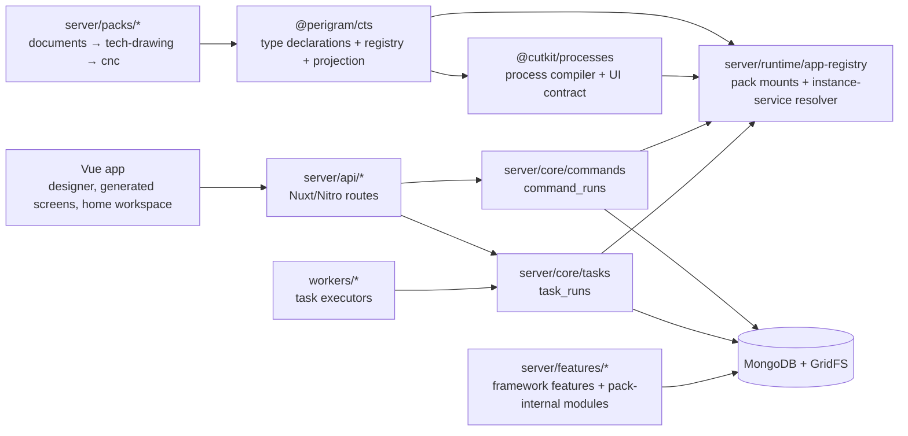
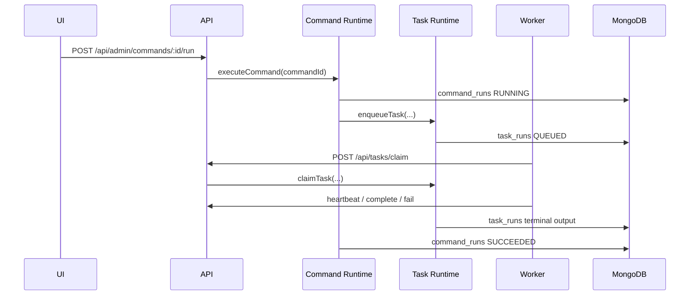

# SYSTEM: CutKit Demo

Multi-tenant CNC manufacturing app and framework extraction sandbox. The app is
a Nuxt/Nitro modular monolith backed by MongoDB and worker services.

## Architecture

Domain vocabulary is authored, not hardcoded: packs and organizations
declare CTS types, the process compiler turns process graphs into runtime
contracts, and generic per-class instance services execute every declared
type (see [docs/SYSTEM_ARCHITECTURE.md](./docs/SYSTEM_ARCHITECTURE.md)).



## Vocabulary

| Term | Definition |
|---|---|
| Entity | Persisted business object with canonical blocks. |
| Command | Synchronous business intent and access boundary, recorded in `command_runs`. |
| Task | Async execution boundary, queued in `task_runs` and claimed by workers/executors. |
| Workflow | Entity lifecycle state machine and transition contract. |
| Hook | Workflow transition side-effect contract and registered handler. |
| Attachment | Persisted file/blob metadata linked to an entity. |
| AttachmentKind | Declared file content/preview/storage contract. |
| Adapter | App binding between pure domain definitions and infrastructure. |
| Process Definition | Organization-owned graph that maps organization roles to entity workflows, field policy, services, sockets, screens, and navigation runtime contracts. Role identity and user assignment remain organization data. |

Commands and tasks are not duplicates: commands decide "what business action is
allowed and requested"; tasks execute retryable background work created by those
commands.

## Containers

| Container | Source | Responsibility |
|---|---|---|
| `cutkit-app` | `server/`, `pages/`, `components/`, `composables/` | Nuxt UI, Nitro API, command/task runtimes, feature services. |
| `file-processing-worker` | `workers/fileprocessing/` | Claims `dxf.parseUpload`, processes uploaded DXF files. |
| `cassette-processing-worker` | `workers/cassette-processing/` | Claims `cassette.bakeTemplate`, bakes cassette geometry. |
| `nesting-worker` | `workers/nesting/` | FastAPI HTTP solver for nesting geometry. |
| `mongo` | Docker image | MongoDB documents and GridFS files. |
| `livekit` | Docker image (`livekit/livekit-server`, `livekit.dev.yaml`) | Self-hosted WebRTC SFU for voice/video calls; rooms are derived and token-gated by the `livekit` capability module. |
| `openknowledge` | `deploy/openknowledge/` (Dockerfile) | Self-hosted OpenKnowledge markdown wiki; org-wide admission is gated by the `knowledge` capability module's authenticated proxy. |

The geometry-capture worker source remains in `workers/geometry-capture/`, but
the neural-network capture worker is not part of the Docker compose stack or
standard image build script.

## Workflows



## Development

```bash
npm install
npx vitest run shared/framework-packages.spec.js shared/design-system.spec.js
npx vitest run --config vitest.ssr.config.js
node scripts/check-arch.js
npm run framework:validate
E2E_BASE_URL=http://localhost:3000 npm run test:e2e
```

The `vitest.ssr.config.js` run mounts real pages through
`vue/server-renderer` with Nuxt globals stubbed (see
[`test-tools/`](./test-tools/README.md)) — it guards against template
bindings that script-only checks cannot see.

Do not run `npm run build` or start dev servers from coding-agent tasks unless a
human explicitly asks. Worker endpoints require matching `WORKER_TOKEN` on app
and workers; compose files use `cutkit-dev-worker` for local development.
Docker dev starts Nuxt with `--host 0.0.0.0` so the app binds to the container
interface and is reachable through the compose `3000:3000` port mapping.
When opening the dev app from another device on the LAN, also set
`NUXT_DEV_HMR_HOST=<your-laptop-LAN-IP>` so the proxied Vite client advertises
the same browser-visible host for hot-module websocket traffic instead of an
internal container-only endpoint. `NUXT_DEV_HMR_CLIENT_PORT` defaults to
`3000`, and `NUXT_DEV_HMR_PROTOCOL` defaults to `ws`.
The E2E command assumes the app stack is already running and uses Playwright
against the configured `E2E_BASE_URL`.
Agent session worktrees are nested under `.agent-worktrees/` in the project
root; the Nuxt/Vite and Nitro dev watchers ignore that tree (`nuxt.config.js`
watch ignores — a path predicate, because chokidar v4 leaks glob-ignored
nested file events), because worktree `tsconfig.json` checkouts otherwise
trip Vite's "changed tsconfig file detected" cache-clear/full-reload loop;
the reload storm then stalls the vite-node SSR module bridge past its 60s
timeout and surfaces as `500: Request timeout after 60000ms for type:
module` for anyone testing against the dev server while an agent session
runs.

## Progressive Web App

The app is an installable, offline-capable PWA with a hand-rolled service
worker (`public/sw.js`, registered by `plugins/pwa.client.js` in production
builds only).

- Fonts, icons, and the manifest are cached cache-first; `/_nuxt/` app
  chunks are never worker-cached (dev serves live modules there, and a
  cache-first worker from an earlier prod build would serve stale code
  through hard refreshes — hashed prod names make network fetches safe);
  `plugins/pwa.client.js` registers the worker without a build plugin.
- Dev loads self-heal the origin: every dev page load unregisters all
  service-worker registrations and deletes their caches, so a worker left
  by an earlier production build cannot keep serving stale code; only
  production builds register `/sw.js`.
- Offline mutations are queued in a client-side IndexedDB outbox
  (`utils/outbox.js`, `stores/outbox.js`) and replayed through the same API
  endpoints when connectivity returns. Entity CRUD (`useEntity`), status
  transitions (`useStateController`), and generated process actions route
  through the outbox; queued operations raise a typed `OfflineQueuedError`,
  and the floating `OfflineOutboxBadge` shows sync state with per-operation
  retry/discard. Successful replays emit the shared entity-event contract, so
  open screens reconcile as if the mutation happened locally.
- Replayed mutations carry an `Idempotency-Key` header deduped by
  `server/core/idempotency` (see
  [its README](./server/core/idempotency/README.md) for the contract).
- Realtime features (connections SSE, LiveKit calls, live chat updates) and
  file uploads remain online-only.
- `public/icon.svg` stays the favicon/install-icon source of truth; the
  rasterized set in `public/favicon/` is generated from it (Inkscape exports
  at 16/32/48/180/192/512; `favicon.ico` packs 16/32/48). Regenerate all sizes
  when the SVG changes instead of editing PNGs by hand.
- The production image mirrors `.output/public` into
  `.output/server/chunks/public` (Dockerfile): the Nuxt 3.19.3 nitro runtime
  resolves inline public assets against the server chunk directory, and
  without the mirror every static asset request 500s.

## Documentation Map

| Area | Doc |
|---|---|
| System graph | [docs/SYSTEM_ARCHITECTURE.md](./docs/SYSTEM_ARCHITECTURE.md) |
| Platform convergence roadmap | [docs/PLATFORM_CONVERGENCE.md](./docs/PLATFORM_CONVERGENCE.md) |
| Remote access and deployment | [docs/REMOTE_ACCESS.md](./docs/REMOTE_ACCESS.md) |
| UI component audit | [docs/UI_COMPONENT_AUDIT.md](./docs/UI_COMPONENT_AUDIT.md) |
| Backend | [server/README.md](./server/README.md) |
| Runtime registry | [server/runtime/README.md](./server/runtime/README.md) |
| Commands | [server/core/commands/README.md](./server/core/commands/README.md) |
| Tasks | [server/core/tasks/README.md](./server/core/tasks/README.md) |
| Domain package | [packages/domain-cnc/README.md](./packages/domain-cnc/README.md) |
| Type system (CTS) | [packages/cts/README.md](./packages/cts/README.md) |
| Process compiler | [packages/processes/README.md](./packages/processes/README.md) |
| Core package | [packages/core/README.md](./packages/core/README.md) |
| Pages and public entry | [pages/README.md](./pages/README.md) |
| Workers | [workers/README.md](./workers/README.md) |
| E2E workflow tests | [e2e/README.md](./e2e/README.md) |
| Scripts and guardrails | [scripts/README.md](./scripts/README.md) |
| Deploy tooling (Forgejo autodeploy) | [deploy/README.md](./deploy/README.md) |
| Schema specs | [docs/specs/README.md](./docs/specs/README.md) |
| Codex agent assets | [.codex/README.md](./.codex/README.md) |
