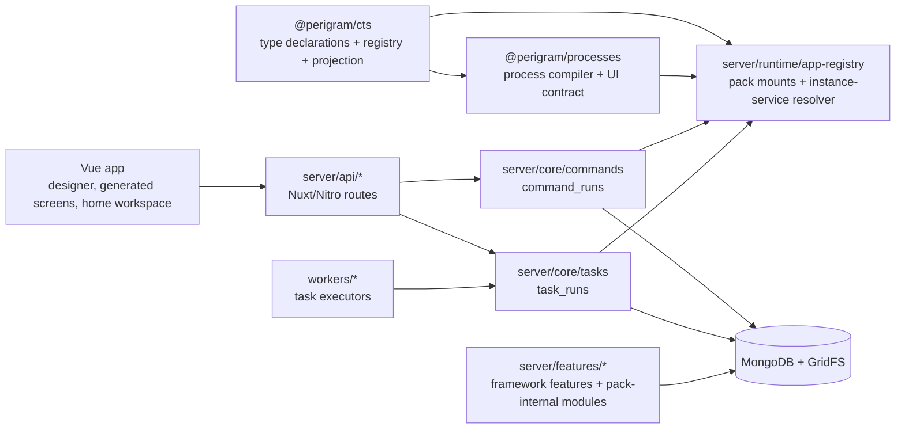
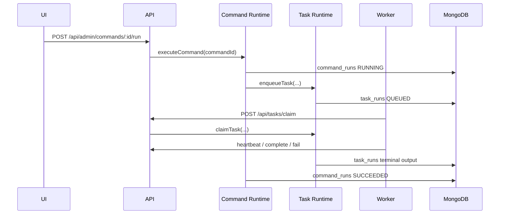

# SYSTEM: Perigram Demo

```yaml
doc_id: PERIGRAM-README-001
classification: reference
status: active
owner: product-owner
created: 2018-06-10
updated: 2026-11-06
```


Perigram is a process programming platform: organizations author typed
declarations, the process compiler turns them into runtime contracts, and
generic instance services run every declared type. This repository is the
demo deployment of that platform — a Nuxt/Nitro modular monolith backed by
MongoDB and worker services, exercising the facade fabrication domain as
an installable plugin with an external executor.

## Architecture

Domain vocabulary is authored, not hardcoded: packs and organizations
declare CTS types, the process compiler turns process graphs into runtime
contracts, and generic per-class instance services execute every declared
type.



## Vocabulary

| Term | Definition |
|---|---|
| Instance | Persisted object of a declared type, served by the generic per-class instance services; carries a flat wire `state` string when its type's producer workflow declares a vocabulary. |
| Command | Synchronous business intent and access boundary, recorded in `command_runs`. |
| Task | Async execution boundary, queued in `task_runs` and claimed by workers/executors. |
| Workflow | Entity lifecycle state machine and transition contract. |
| Hook | Workflow transition side-effect contract and registered handler. |
| Attachment | File/blob reference: a chat message's file descriptor (`kind`, `fileId`, `mimeType`, `name`, `size`) or a file instance's `payload` slot; blobs live in the `files` GridFS bucket. |
| AttachmentKind | A declared file type's payload traits, keyed by type id: creation protocols (`upload`/`capture`/`editor`/`content`), accepted MIME, size limit, preview mode. |
| Adapter | App binding between pure domain definitions and infrastructure. |
| Process Definition | Organization-owned graph that maps organization roles to entity workflows, field policy, services, sockets, screens, and navigation runtime contracts. Role identity and user assignment remain organization data. |

Commands and tasks are not duplicates: commands decide "what business action is
allowed and requested"; tasks execute retryable background work created by those
commands.

## Containers

| Container | Source | Responsibility |
|---|---|---|
| `perigram-app` | `server/`, `pages/`, `components/`, `composables/` | Nuxt UI, Nitro API, command/task runtimes, feature services. |
| `nesting-worker` | `workers/nesting/` | FastAPI HTTP solver for nesting geometry. |
| `documents-executor` | `workers/documents/` | The documents plugin's endpoint-mode executor (table projections, text extraction, CSV composition, template fills and PDF rendering; serves the text/csv editor surfaces and their vendored runtimes as static GETs). |
| `facade-executor` | `workers/facade/` | The facade plugin's endpoint-mode executor (DXF/OCCS/nesting compute over values; serves the plugin's editor and preview surface modules as static GETs). |
| `tech-drawing-executor` | `workers/tech-drawing/` | The tech-drawing plugin's executor: serves the DXF placement service, the sketch editor surface module, and its vendored runtime dependencies. |
| `mongo` | Docker image | MongoDB documents and GridFS files. |
| `livekit` | Docker image (`livekit/livekit-server`, `livekit.dev.yaml`) | Self-hosted WebRTC SFU for voice/video calls; rooms are derived and token-gated by the `livekit` capability module. Call recordings ride an external egress plane (LiveKit + Redis + `livekit/egress` + an S3-compatible bucket) deployed beside whichever server the app targets. |

## Workflows



## Development

```bash
npm install
npx vitest run shared/framework-packages.spec.js shared/design-system.spec.js
npx vitest run --config vitest.ssr.config.js
node scripts/check-arch.js
npm run framework:validate
E2E_BASE_URL=http://localhost:3000 npm run test:e2e
```

The `vitest.ssr.config.js` run mounts real pages through
`vue/server-renderer` with Nuxt globals stubbed (see
[`test-tools/`](./test-tools/README.md)) — it guards against template
bindings that script-only checks cannot see.

Worker endpoints require matching `WORKER_TOKEN` on app and workers;
the dev compose defaults it to `perigram-dev-worker`. Data
migrations live in their canonical home,
[server/scripts/README.md](./server/scripts/README.md).
Docker dev starts Nuxt with `--host 0.0.0.0` so the app binds to the container
interface and is reachable through the compose `3000:3000` port mapping.
When opening the dev app from another device on the LAN, set
`NUXT_DEV_HMR_HOST=<your-laptop-LAN-IP>` so the proxied Vite client advertises
the browser-visible host for hot-module websocket traffic.
`NUXT_DEV_HMR_CLIENT_PORT` defaults to `3000`, and `NUXT_DEV_HMR_PROTOCOL`
defaults to `ws`.
The E2E command assumes the app stack is already running and uses Playwright
against the configured `E2E_BASE_URL`.
Dev-stack filesystem runbook (compose mounts the repo at `/src`):
- Global stylesheets ride `plugins/global-styles.js`, not the Nuxt `css:`
  array: with Nuxt 3.19's vite builder, css-array entries land only in the
  SSR `entry-styles` sidecar, so production browsers miss
  tailwind/primeicons/main.css/the PrimeVue theme; dev and scoped
  styles are unaffected.

- `node_modules` is an anonymous container volume (`/src/node_modules`):
  host-side installs never reach the running container. The dependency
  refresh runbook lives in [deploy/README](./deploy/README.md)
  (Development Stack).
- Both compose files cap mongo's WiredTiger cache at 0.5 GB
  (`--wiredTigerCacheSizeGB`): an unlimited container sizes the cache to
  host RAM (50% of visible − 1 GB ≈ 6.9 GB here) and slowly starves the
  machine, while the dev database is well under that.
- The container writes `.nuxt` as root. Host-side tooling that needs it
  (the SSR smoke's `.nuxt/tsconfig.json`, `npx nuxi prepare` in agent
  worktrees) fails on root-owned files — fix ownership once with
  `sudo chown -R "$(id -u):$(id -g)" .nuxt` (a fresh worktree runs
  `npx nuxi prepare` and regenerates its own).
- The compose stack declares `perigram-network` as an external bridge; a
  missing network fails compose with "network declared as external, but
  could not be found". Create it once (`docker network create
  perigram-network`) and run `docker compose -f docker-compose.dev.yml up -d
  app` to move the services onto it; mongo keeps its named volume across
  the recreate.
Agent session worktrees sit nested under `.agent-worktrees/`,
`.agent/worktrees/`, and scratch dirs `.agent-wt*` in the project root; a
worktree is removed once its branch merges. `nuxt.config.js` ignores those
trees and `.opencode/` for scanning and dev watchers.
The per-environment `vite.environments.*` watcher ignores are attached
only in development: a user-level `environments` object in a production
build deroutes the vite 7 SSR output and nitro fails with `Could not load
.nuxt/dist/server/server.mjs`, so run a production build when touching
that config; dev and the guards skip the SSR bundle emit.
- Theme tokens are startup-evaluated: the PrimeVue preset chain
  (`assets/tokens/index.js` → `assets/presets/re_l.js` → `nuxt.config.js`)
  bakes component tokens into the running theme at boot. Nuxt restarts
  when `nuxt.config.js` itself changes but not when its imports do, so a
  token-table edit stays invisible to a running dev server — component
  pt and CSS changes hot-reload, token changes need an app restart
  (`docker compose -f docker-compose.dev.yml restart app`).
Server-side `xlsx` imports target the package's ESM build
(`import … from 'xlsx/xlsx.mjs'`); importing the CJS main breaks every
nitro server-bundle rebuild.
- Server-side imports of workspace packages use the `#packages/…` alias:
  chunk-relative `~` externals can hoist into the root dev entry with the
  wrong depth and crash startup
  (`Cannot find module '/packages/…'`); `#packages` externalizes
  absolutely.

## Progressive Web App

The app is an installable, offline-capable PWA with a hand-rolled service
worker (`public/sw.js`, registered by `plugins/pwa.client.js` in production
builds only).

- Static decoration — fonts, icons, the favicon set, the manifest — is
  cached cache-first; only successful (`response.ok`, same-origin)
  responses are ever cached — error bodies and `206 Partial Content`
  range responses (browser media playback against `GET /api/**`) must
  not enter a cache: the Cache API rejects partials, and a partial body
  keyed to the full request would poison the offline fallback. Bumping
  the worker's cache version purges every client cache on activate.
- Everything the app needs to load and read offline — HTML navigations,
  `/_nuxt/` app chunks, and `GET /api/**` reads — is cached network-first:
  online loads stay fresh from the network, and offline loads fall back to
  the last successful response. An offline navigation falls back to the
  exact cached document, then the cached root shell, then the shell marker
  — the URL of the last navigation document that entered the cache
  (authenticated visits to `/` are SSR redirects, and redirect responses
  never enter the cache). The fetch-handler chain is pinned by
  `utils/sw.spec.js`. The `/api/connections`
  SSE stream is never intercepted or cached.
- Dev loads self-heal the origin: every dev page load unregisters all
  service-worker registrations and deletes their caches, so a worker left
  by an earlier production build cannot keep serving stale code; only
  production builds register `/sw.js`.
- Offline mutations are queued in a client-side IndexedDB outbox
  (`utils/outbox.js`, `stores/outbox.js`) and replayed through the same API
  endpoints when connectivity returns. The browser's own offline state gates
  the queue; a server outage that fails in-flight requests latches the tab
  offline, and the next mutation on a browser-online tab attempts anyway —
  success heals the latch and replays the queue. Entity CRUD (the instances
  store), status transitions (`useStateController`), and generated
  process actions route through the outbox; queued operations raise a
  typed `OfflineQueuedError`,
  and the floating `OfflineOutboxBadge` shows sync state with per-operation
  retry/discard. Successful replays emit the shared entity-event contract, so
  open screens reconcile as if the mutation happened locally.
- The outbox operation machine (`stores/outbox.js`, `utils/outbox.js`):

  | From | Event/guard | To |
  |---|---|---|
  | — | enqueue while offline, or a network failure mid-flight | `pending` (persisted) |
  | `pending` | replay 2xx or an idempotent duplicate response | deleted |
  | `pending` | replay 4xx | `failed` |
  | `pending` | replay 5xx, 429, or network failure | `pending`; flush stops |
  | `failed` | retry | `pending` |
  | `failed` | discard | deleted |

  Connectivity is `online`/`offline`; a network failure latches `offline`
  and the next successful mutation or the browser's `online` event returns
  it to `online`. The persisted operation's `status` is its one state
  value; the store's `operations` list mirrors storage.
- Replayed mutations carry an `Idempotency-Key` header deduped by
  `server/core/idempotency` (see
  [its README](./server/core/idempotency/README.md) for the contract).
- Realtime features (connections SSE, LiveKit calls, live chat updates) and
  file uploads remain online-only.
- `public/icon.svg` stays the favicon/install-icon source of truth; the
  rasterized set in `public/favicon/` is generated from it (Inkscape exports
  at 16/32/48/180/192/512; `favicon.ico` packs 16/32/48). Regenerate all
  sizes when the SVG changes — the PNGs are generated artifacts.
- The production image mirrors `.output/public` into
  `.output/server/chunks/public` (Dockerfile): the Nuxt 3.19.3 nitro runtime
  resolves inline public assets against the server chunk directory, and
  without the mirror every static asset request 500s.

## Documentation Map

`npm run docs:map` prints the whole README tree as an outline with links
(`--near <path>` narrows to one README's contract neighborhood) — see
[scripts/README.md](./scripts/README.md).

| Area | Doc |
|---|---|
| Backend | [server/README.md](./server/README.md) |
| Runtime registry | [server/runtime/README.md](./server/runtime/README.md) |
| Commands | [server/core/commands/README.md](./server/core/commands/README.md) |
| Tasks | [server/core/tasks/README.md](./server/core/tasks/README.md) |
| Agent AI (delegated runs, tool catalog, MCP) | [server/features/agent-bots/README.md](./server/features/agent-bots/README.md) |
| LLM providers | [server/features/llm/README.md](./server/features/llm/README.md) |
| Web search (agent `web_search` tool) | [server/features/web-search/README.md](./server/features/web-search/README.md) |
| Documents plugin (executor + listing) | [workers/documents/README.md](./workers/documents/README.md) |
| Facade plugin (executor + listing) | [workers/facade/README.md](./workers/facade/README.md) |
| Tech-drawing plugin (executor + listing) | [workers/tech-drawing/README.md](./workers/tech-drawing/README.md) |
| Type system (CTS) | [packages/cts/README.md](./packages/cts/README.md) |
| Process compiler | [packages/processes/README.md](./packages/processes/README.md) |
| Core package | [packages/core/README.md](./packages/core/README.md) |
| Pages and public entry | [pages/README.md](./pages/README.md) |
| Workers | [workers/README.md](./workers/README.md) |
| E2E workflow tests | [e2e/README.md](./e2e/README.md) |
| Scripts and guardrails | [scripts/README.md](./scripts/README.md) |
| Deploy tooling (Forgejo autodeploy) | [deploy/README.md](./deploy/README.md) |
| Plugin SDK | [packages/plugin-sdk/README.md](./packages/plugin-sdk/README.md) |
| Codex agent assets | [.codex/README.md](./.codex/README.md) |
| Workspace packages map | [packages/README.md](./packages/README.md) |
| Component tree | [components/README.md](./components/README.md) |
| Composables | [composables/README.md](./composables/README.md) |
| Client stores | [stores/README.md](./stores/README.md) |
| Shared contracts | [shared/README.md](./shared/README.md) |
| Client utilities | [utils/README.md](./utils/README.md) |
| Layouts | [layouts/README.md](./layouts/README.md) |
| Route middleware | [middleware/README.md](./middleware/README.md) |
| Localization | [i18n/README.md](./i18n/README.md) |
| Design assets and tokens | [assets/README.md](./assets/README.md) |
| Test data factories | [test-data/README.md](./test-data/README.md) |
| SSR smoke tooling | [test-tools/README.md](./test-tools/README.md) |
| Production cluster | [k8s/README.md](./k8s/README.md) |
| Deslopification program | [TODO.md](./TODO.md) (root; folder SPEC.md/TODO.md deltas) |
