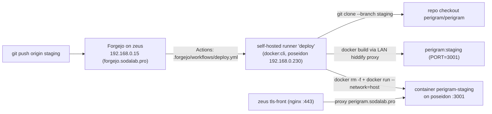

# COMPONENT: Deploy Tooling

Target law: [SPEC.md](./SPEC.md).

The CI deploy runs as a Forgejo Action on the self-hosted runner (poseidon,
label `deploy`). The CI deploy **is the public app** at
`perigram.sodalab.pro`; hera keeps the data plane (MongoDB, LiveKit).

## Current Pipeline



The workflow file lives **on the `staging` branch**
(`.forgejo/workflows/deploy.yml`) because only staging deploys from it.
Editing the pipeline means editing that branch.

## Contract

- Trigger: push to `staging` in `perigram/perigram`. Every merge into staging
  redeploys the public app.
- The runner clones from `forgejo.sodalab.pro` resolved to `192.168.0.15`
  via `--add-host` (LAN path, not the public edge).
- Build networking: `registry.npmjs.org` is provider-blocked on runner hosts,
  so the `npm ci` layer pins `HTTP_PROXY/HTTPS_PROXY` to the LAN hiddify relay
  `http://192.168.0.100:12334` with `NO_PROXY` covering localhost, LAN and
  NetBird ranges. `--dns-result-order=ipv4first`
  is kept as a harmless belt-and-suspenders.
- Image: production `Dockerfile` (multi-stage `npm ci` → `npm run build`).
- Rollout: the old `perigram-staging` container is removed and recreated with
  `--restart unless-stopped --network=host` on port `3001`. The build happens
  before the removal, so failed builds leave the previous container serving.
  After rollout the pipeline verifies the served app is this build: every
  `/_nuxt` chunk the served document references must exist in the image the
  pipeline built (chunk names are content-hashed; a port squatter or a
  crash-looped container serving an earlier build fails the deploy instead
  of going green). The rendered document itself ships `max-age=0` — only
  hashed assets and icons/fonts are cacheable — so a deploy is visible the
  moment it lands, never a shared-cache day behind.
- Public edge: nginx on zeus — the `tls-front-443` / `tls-front` /
  `tls-portprobe` containers share `/home/storage/nginx-mixed.conf`; the
  `perigram.sodalab.pro` server block proxies to `http://192.168.0.230:3001`
  (512 MB upload limit) through the `perigram_staging` upstream with
  `keepalive 32` — a new TCP connection per proxied request lost its first
  SYN to port-collision drops on the zeus→poseidon path, stalling asset
  loads ~1s each and breaking first paint; the keepalive pool keeps warm
  upstream connections instead. The http block also carries `gzip on` with
  `gzip_proxied any` for html/json/svg: the proxied SSR document is
  ~740KB raw and streamed uncompressed for seconds over a thin WAN
  uplink, painting the shell unstyled until CSS lands; compressed it
  ships at ~100KB. **Rollback to the hera K3s ingress:** point
  the upstream back to `http://192.168.0.248:80` in that block and
  `nginx -s reload`.
- Data plane (values inline in `deploy.yml` — lab LAN/NetBird — with the
  LiveKit and garage S3 credentials from Forgejo secrets):
  `NUXT_MONGODB_URI=mongodb://192.168.0.248:27017/cutkit?directConnection=true`
  (hera mongo; `directConnection=true` is required — the single-node
  replica set advertises its own hostname to clients, and from outside the
  mongo network that name does not resolve, the driver topology closes, and
  every API 500s while pages still render),
  `BASE_URL=https://perigram.sodalab.pro`, calls on the
  zeus LiveKit through the app origin (`wss://perigram.sodalab.pro/livekit`
  → the plane's 7880 with websocket upgrade headers — one hostname for every
  client network the app itself works on; the dedicated
  `livekit.sodalab.pro` server block stays as an alias; RoomService
  traffic from the runner rides the LAN address `ws://192.168.0.15:7880`,
  since poseidon is not a NetBird peer), local STT + qwen on the
  data-worker peer (`10.77.167.148:31135/:31136`) — reached through
  `192.168.0.15:31135/:31136`, host-network socat forwards on zeus
  (`stt-forward` / `llm-forward` containers, NetBird upstream), since the
  runner has no NetBird route — and recordings in the
  `livekit-egress` garage bucket — read through the app edge
  (`https://perigram.sodalab.pro/recordings/...` → garage web `:3902`),
  uploaded with the garage keys (Forgejo secrets) through the plane-local
  S3 API (`http://127.0.0.1:8333`, see
  [the livekit feature](../server/features/livekit/README.md#recordings)).
- Call recordings need an external egress plane beside the LiveKit server
  the app targets: Redis, a `livekit/egress` container (SYS_ADMIN for
  Chrome), and an S3-compatible bucket readable by the app
  (`LIVEKIT_RECORDINGS_S3_*` env). The working plane on zeus runs
  host-networked (`/srv/livekit/docker-compose.yml`): LiveKit with
  `rtc.udp_port: 50100` (a single UDP mux port — a `port_range_*`-only
  config parses but binds **no** UDP socket, and every peer connection
  dies with `could not establish pc connection`), redis and the garage S3
  API bound to localhost, garage's web endpoint (`:3902`) public through
  the perigram vhost. UFW on zeus allows 7880/7881/tcp and 50100/udp from
  the LAN; the NetBird `wt0` interface is accept-all.
- The nginx edge containers bind-mount the **single file**
  `/home/storage/nginx-mixed.conf`; an edit that replaces the file (editors
  and `sed -i` do) leaves the running containers pinned to the old inode —
  `nginx -s reload` then reloads stale config. Restart the `tls-front*`
  containers after editing it.
- The `netbird.sodalab.pro` vhost carries `http2 on;` on its listener
  (2026-10-03): gRPC management streams over TLS `:443` require HTTP/2 via
  ALPN, and without it a peer enrolled with
  `https://netbird.sodalab.pro:443` registers but never holds a stream —
  `RST_STREAM … PROTOCOL_ERROR` reconnect loop, no WireGuard handshakes.
  Peers on the plain `http://85.174.249.129:8081` path never traverse
  nginx: signal and relay ride sslh → `127.0.0.1:18081` straight into
  `netbird-server:80`, which is why the mesh mostly worked while the TLS
  path was broken.
- The nginx config also carries a dormant `staging.perigram.sodalab.pro`
  server block (same target); it is unreachable until a DNS record exists
  for that name. It can be activated or deleted independently.

## Configuration

Credential values come from Forgejo repository secrets
(**Settings → Actions → Secrets**) and are passed by the workflow:

| Secret | Consumed by | State |
|---|---|---|
| `VAPID_PUBLIC_KEY` / `VAPID_PRIVATE_KEY` | Web Push | empty = push disabled |
| `LIVEKIT_API_KEY` / `LIVEKIT_API_SECRET` | LiveKit RoomService (calls on the zeus plane) | required |
| `GARAGE_ACCESS_KEY` / `GARAGE_SECRET_KEY` | `LIVEKIT_RECORDINGS_S3_*` (egress bucket upload) | required |

Web Push enablement runbook: generate a key pair once with
`npx web-push generate-vapid-keys` (`web-push` ships with the app
dependencies), store the two values as the secrets above, and push to
`staging` — the workflow passes them through as `NUXT_VAPID_PUBLIC_KEY` /
`NUXT_VAPID_PRIVATE_KEY` and the redeploy reconfigures push. Until both
secrets exist the server reports push disabled
(`/api/notifications/config` → `enabled: false`) and the profile
notifications toggle shows that only in-tab delivery is active.

`NUXT_MONGODB_URI` / `TRANSCRIPTION_*` / `MEETINGS_*` ride inline in the
workflow (see Contract). ConfigBot/Ollama
env is intentionally absent on this deploy — it is a prod-only,
cluster-internal feature.

## Plugin marketplace release steps

The CI deploys the whole plugin plane beside the app: the nesting
worker, the three plugin executors (each a `workers/plugin-executor.Dockerfile`
image — the plugin's own dependency install beside the zero-dep SDK),
the catalog seed (its own image: `perigram-seed`, built from
`deploy/seed.Dockerfile`), and the idempotent per-org builtin installs
(facade/tech-drawing/documents) run on every push to `staging`; the
app carries the executor URLs (`FACADE/DOCUMENTS/TECH_DRAWING_EXECUTOR_URL`
on 127.0.0.1:879x), and a post-start probe fails the deploy when an
executor port stays silent. The seed scripts also refresh held
installs' connection wiring (endpoints, surface origin) to the
deploy's executor URLs — declaration pins move only through the
upgrade flow. Listing version bumps ride the same push: installed
organizations see the upgrade in the Plugins page.

```bash
NUXT_MONGODB_URI=mongodb://192.168.0.248:27017/cutkit?directConnection=true \
  node server/scripts/seed-plugin-catalog.js
```

The dev stack keeps its compose services (`docker-compose.dev.yml`) — the
same executors with the repo bind-mounted where the CI deploy runs images.

## Development Stack

Local development uses `docker-compose.dev.yml` + `Dockerfile.dev`: source is
bind-mounted at `/src` while `node_modules` comes from an anonymous volume
backed by the image. After any dependency change, rebuild **and** recreate
with `docker compose -f docker-compose.dev.yml up -d app --renew-anon-volumes`
— a plain rebuild keeps the stale module set — or reinstall inside the
container (`docker compose -f docker-compose.dev.yml run --rm app npm install`).
LAN dev needs `NUXT_DEV_HMR_HOST` (root README, Development).

## Contents

`deploy/` owns deployables: `seed.Dockerfile` (the catalog-seed image
`deploy.yml` builds) and this README (the Forgejo autodeploy contract).
Cluster state — the hera production environment and its env — is
[k8s/README.md](../k8s/README.md).

## Related

- [System README](../README.md)

- `debug-logs.yml` (manual dispatch from Forgejo Actions) prints the last
  push/notification lines and recent output of the staging container — use it
  before SSH-ing anywhere to read server-side push diagnostics.
