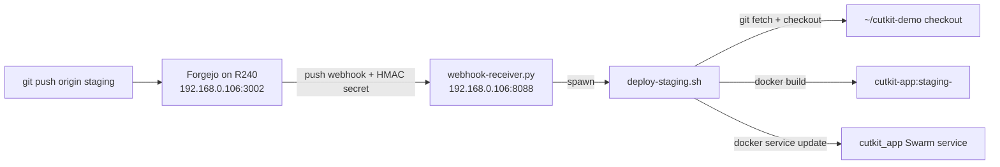

# COMPONENT: Deploy Tooling

Self-hosted deployment tooling for the R240 Swarm target. This directory owns
the Forgejo push-to-deploy pipeline: a webhook receiver, the staging deploy
runner, the systemd unit that keeps the receiver alive, and the installer that
wires everything to Forgejo.

## Pipeline



A push to the `staging` branch on the Forgejo `origin` triggers a rebuild and
roll of the app. Pushes to any other ref are acknowledged and ignored.

## Files

- `webhook-receiver.py` - stdlib-only HTTP server. Verifies the
  `X-Forgejo-Signature` HMAC-SHA256 against the shared secret, and runs the
  deploy script only for `refs/heads/staging`.
- `deploy-staging.sh` - fetches `origin/staging`, resets the checkout, builds
  `cutkit-app:staging-<short-sha>` (with the R240 Hiddify HTTP proxy for the
  `npm ci` registry downloads), then rolls the `cutkit_app` service.
- `cutkit-autodeploy.service` - user systemd unit (linger is enabled for
  `cutkit`, so no root unit is required).
- `install-autodeploy.sh` - idempotent installer. Copies the receiver/runner to
  `~/autodeploy`, writes/keeps `webhook.env` (secret + bind/port), enables the
  user service, and registers the Forgejo push webhook.

## Install

```bash
bash deploy/install-autodeploy.sh 192.168.0.106:3002 <admin-token> cutkit/cutkit-demo
```

The installer must run as the `cutkit` user on R240 (or with the same HOME).
Secrets are stored only in `~/autodeploy/webhook.env` (mode `0600`) and never
in the repository.

## Runtime configuration

`webhook.env` supports:

| Variable | Default | Purpose |
|---|---|---|
| `CUTKIT_WEBHOOK_SECRET` | - | HMAC secret shared with the Forgejo webhook |
| `CUTKIT_WEBHOOK_BIND` | `192.168.0.106` | Receiver listen address |
| `CUTKIT_WEBHOOK_PORT` | `8088` | Receiver listen port |
| `CUTKIT_DEPLOY_BRANCH` | `refs/heads/staging` | Ref that triggers a deploy |

`deploy-staging.sh` additionally honors `CHECKOUT_DIR`, `SERVICE_NAME`,
`IMAGE_PREFIX`, and `HTTP_PROXY_PORT`.

## Related

- [Remote access runbook](../docs/REMOTE_ACCESS.md) - VPN/SSH targets and the
  legacy bare-repo deploy path.
- [Deployment guide](../docs/DEPLOYMENT.md) - Railway and Swarm deployment.
- [System README](../README.md) - containers and project-wide commands.
