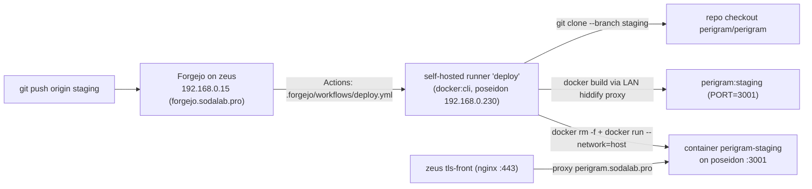

# COMPONENT: Deploy Tooling

The CI deploy runs as a Forgejo Action on the self-hosted runner (poseidon,
label `deploy`). Since 2026-09-27 (owner word) the CI deploy **is the public
app** at `perigram.sodalab.pro`; hera keeps the data plane (MongoDB, LiveKit).

## Current Pipeline

The workflow file lives **on the `staging` branch**
(`.forgejo/workflows/deploy.yml`) because only staging deploys from it.
Editing the pipeline means editing that branch.

## Contract

- Trigger: push to `staging` in `perigram/perigram`. Every merge into staging
  redeploys the public app.
- The runner clones from `forgejo.sodalab.pro` resolved to `192.168.0.15`
  via `--add-host` (LAN path, not the public edge).
- Build networking: `registry.npmjs.org` is provider-blocked on runner hosts,
  so the `npm ci` layer pins `HTTP_PROXY/HTTPS_PROXY` to the LAN hiddify relay
  `http://192.168.0.100:12334` with `NO_PROXY` covering localhost, LAN and
  NetBird ranges (Штаб coordination 2026-09-27). `--dns-result-order=ipv4first`
  is kept as a harmless belt-and-suspenders.
- Image: production `Dockerfile` (multi-stage `npm ci` → `npm run build`).
- Rollout: the old `perigram-staging` container is removed and recreated with
  `--restart unless-stopped --network=host` on port `3001`. The build happens
  before the removal, so failed builds leave the previous container serving.
- Public edge: nginx on zeus — the `tls-front-443` / `tls-front` /
  `tls-portprobe` containers share `/home/storage/nginx-mixed.conf`; the
  `perigram.sodalab.pro` server block proxies to `http://192.168.0.230:3001`
  (512 MB upload limit). **Rollback to the hera K3s ingress:** point `$f`
  back to `http://192.168.0.248:80` in that block and `nginx -s reload`.
- Data plane on hera (inline in deploy.yml, no credentials — lab LAN):
  `NUXT_MONGODB_URI=mongodb://192.168.0.248:27017/cutkit`,
  `LIVEKIT_INTERNAL_URL=http://192.168.0.248:7880`,
  `BASE_URL=https://perigram.sodalab.pro`.
- The nginx config also carries a dormant `staging.perigram.sodalab.pro`
  server block (same target); it is unreachable until a DNS record exists
  for that name. It can be activated or deleted independently.

## Configuration

Auth-only values still come from Forgejo repository secrets
(**Settings → Actions → Secrets**) and are passed by the workflow:

| Secret | Consumed by | State (2026-09-27) |
|---|---|---|
| `LIVEKIT_API_KEY` / `LIVEKIT_API_SECRET` | LiveKit token minting | **stale** — hold the retired poseidon-staging keys and do not match hera's LiveKit; video calls fail until the hera values are pasted here |
| `VAPID_PUBLIC_KEY` / `VAPID_PRIVATE_KEY` | Web Push | empty = push disabled, as before |

`NUXT_MONGODB_URI` / `LIVEKIT_*_URL` / `BASE_URL` no longer come from
secrets (see Contract). ConfigBot/Ollama env is intentionally absent on this
deploy — it is a prod-only, cluster-internal feature.

## Development Stack

Local development uses `docker-compose.dev.yml` + `Dockerfile.dev`: source is
bind-mounted at `/src` while `node_modules` comes from an anonymous volume
backed by the image. After any dependency change, rebuild **and** recreate
with `docker compose -f docker-compose.dev.yml up -d app --renew-anon-volumes`
— a plain rebuild keeps the stale module set. LAN dev needs
`NUXT_DEV_HMR_HOST` (root README, Development).

## Legacy

Retired paths, kept for archaeology until deleted:

- `webhook-receiver.py`, `deploy-staging.sh`, `install-autodeploy.sh`,
  `perigram-autodeploy.service` — the old R240 push-webhook pipeline (Swarm
  service `perigram_app`, port 7100). R240 is no longer part of any deploy.
- `.github/workflows/publish.yml` — the old GitHub Actions path (ghcr.io
  images, `docker stack deploy` to the Hetzner host). The GitHub remote is a
  mirror only.
- Railway production (`perigram-demo-production.up.railway.app`) is
  decommissioned.
- The `staging.perigram.sodalab.pro` public name (2026-09-27 evening) was
  prepared and then dropped by owner word in favour of the plain
  `perigram.sodalab.pro`; no DNS record was ever created.

## Related

- [Remote access runbook](../docs/REMOTE_ACCESS.md)
- [System README](../README.md)
