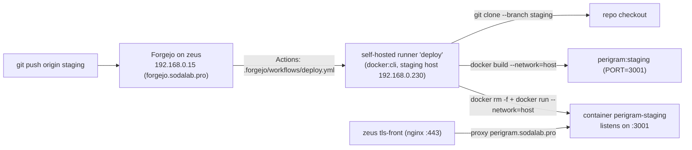

# COMPONENT: Deploy Tooling

Staging deployment runs as a Forgejo Action on the self-hosted runner. The
files in this directory are the retired legacy pipeline (see
[Legacy](#legacy)) and are kept only for reference.

## Current Pipeline

The workflow file lives **on the `staging` branch** (`.forgejo/workflows/deploy.yml`),
not on `local`/`main`, because only staging deploys from it. Editing the
pipeline means editing that branch.

## Contract

- Trigger: push to `staging` on Forgejo (`sodalab/perigram`). Every merge into
  staging redeploys.
- The runner clones the staging branch from `forgejo.sodalab.pro`, resolved to
  `192.168.0.15` via `--add-host` because the runner host reaches Forgejo over
  the LAN, not through the public edge.
- Image: production `Dockerfile` (multi-stage `npm ci` → `npm run build`;
  the runtime image mirrors `.output/public` into
  `.output/server/chunks/public` for Nitro asset resolution — see the root
  README PWA section).
- Rollout: the old `perigram-staging` container is removed and recreated with
  `--restart unless-stopped --network=host` on port `3001`. There is a
  seconds-long downtime window between `docker rm` and `docker run`; the
  build happens before the removal, so failed builds leave the previous
  container serving.
- Public edge: `perigram.sodalab.pro` terminates TLS on the zeus `tls-front`
  nginx container and proxies to `http://192.168.0.230:3001` (512 MB upload
  limit).

## Configuration

Runtime secrets come from the Forgejo repository
(**Settings → Actions → Secrets**) and are passed by the workflow as `-e`
environment variables:

| Secret | Consumed by |
|---|---|
| `NUXT_MONGODB_URI` | Mongo connection |
| `LIVEKIT_PUBLIC_URL` / `LIVEKIT_INTERNAL_URL` | LiveKit client/server endpoints |
| `LIVEKIT_API_KEY` / `LIVEKIT_API_SECRET` | LiveKit token minting |
| `VAPID_PUBLIC_KEY` / `VAPID_PRIVATE_KEY` | Web Push (empty = push disabled) |

Adding an environment variable is a two-part change: an `-e` line in the
workflow on `staging`, and the value as a Forgejo secret. Never commit secret
values.

## Development Stack

Local development uses `docker-compose.dev.yml` + `Dockerfile.dev`: source is
bind-mounted at `/src` while `node_modules` comes from an anonymous volume
backed by the image. After any dependency change, rebuild **and** recreate
with `docker compose -f docker-compose.dev.yml up -d app --renew-anon-volumes`
— a plain rebuild keeps the stale module set. LAN dev needs
`NUXT_DEV_HMR_HOST` (root README, Development).

## Legacy

Retired paths, kept for archaeology until deleted:

- `webhook-receiver.py`, `deploy-staging.sh`, `install-autodeploy.sh`,
  `perigram-autodeploy.service` — the old R240 push-webhook pipeline (Swarm
  service `perigram_app`, port 7100). R240 is no longer part of any deploy.
- `.github/workflows/publish.yml` — the old GitHub Actions path (ghcr.io
  images, `docker stack deploy` to the Hetzner host). The GitHub remote is a
  mirror only.
- Railway production (`perigram-demo-production.up.railway.app`) is
  decommissioned.

## Related

- [Remote access runbook](../docs/REMOTE_ACCESS.md)
- [System README](../README.md)
