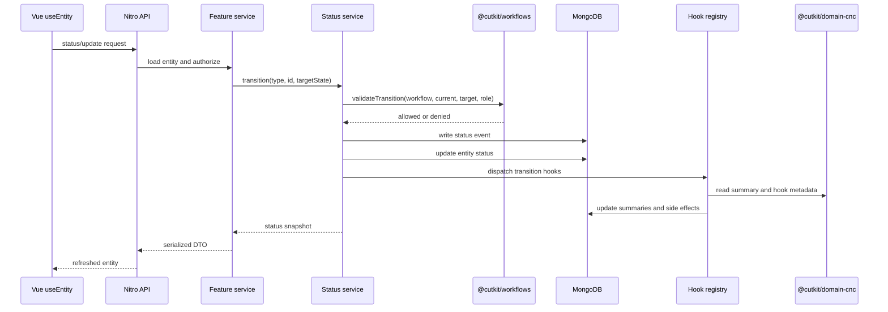
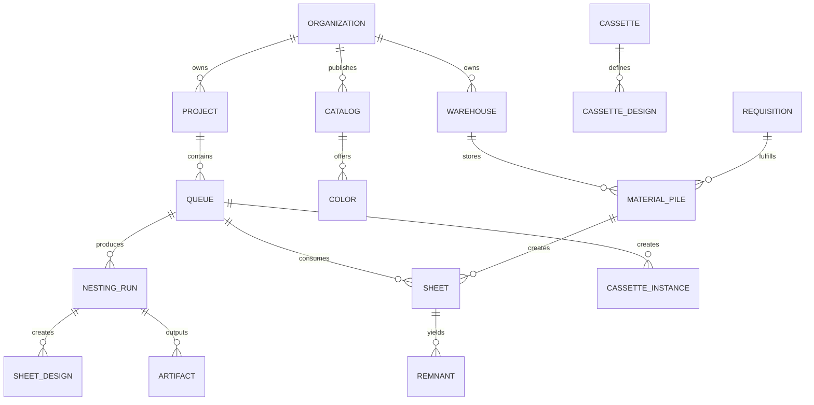
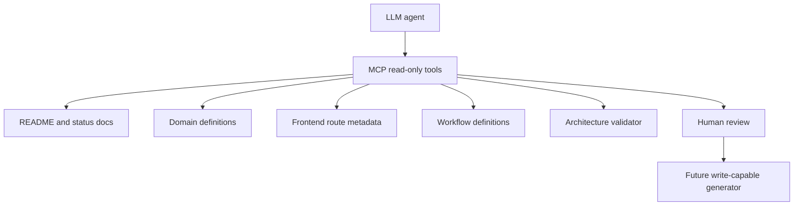

# Framework Extraction Status

Current execution status for separating the Cutkit industrial workflow model into reusable packages and API surfaces that an LLM/RAG/MCP layer can inspect before generating apps.

## Status

| Workstream | Status | Current result |
|---|---|---|
| v24 entity baseline | Done | `scripts/check-arch.js` verifies strict Golden Path entity modules separately from support capabilities. |
| Framework workspace | Done | Private workspace packages exist under `packages/*`. Runtime imports remain stable through app wrappers. |
| Core entity kernel | Done | `server/core/blocks/index.js` now wraps `@cutkit/core` while preserving server-specific ID behavior. |
| Workflow kernel | Done | Runtime status transitions delegate validation to `@cutkit/workflows`. |
| CNC domain pack | Done | Entity, workflow, summary, and frontend route metadata live in `@cutkit/domain-cnc`. |
| Frontend adapter | Done | `composables/useEntity.js` builds endpoint metadata through `@cutkit/vue`. |
| Summary adapter | Done | Machine aggregation derives summary rules from `cncSummaries`. |
| UI/design-system framework contract | Done | `framework.manifest.json` snapshots UI components, status policies, field paths, and token projections. |
| Read-only devtools/MCP | In progress | CLI and MCP-style handlers expose entities, workflows, routes, docs lookup, UI components, relationships, summaries, manifest data, transition simulation, and validation. |
| Write-capable app builder | Not started | Intentionally blocked until read-only inspection contracts are stable. |
| External package publishing | Not started | Packages are private workspace packages; no separate repo or registry publish exists yet. |

## Verification

Run these checks after framework changes:

```bash
node scripts/check-arch.js
npm run framework:manifest
npm run framework:validate
npx vitest run --reporter=dot
```

The latest completed execution for this update passed `node scripts/check-arch.js`, `npm run framework:manifest`, `npm run framework:validate`, and `npx vitest run --reporter=dot`.

## Module Boundaries

```mermaid
flowchart LR
  App[Cutkit Nuxt app]
  ServerBlocks[server/core/blocks/index.js]
  StatusService[server/core/machines/service.js]
  Aggregator[server/core/machines/aggregator.js]
  UseEntity[composables/useEntity.js]
  DesignSystem[utils/design-system-contract.js]
  Tokens[assets/tokens/index.js]
  Manifest[framework.manifest.json]
  InspectCLI[scripts/framework-inspect.js]

  CorePkg[@cutkit/core]
  WorkflowPkg[@cutkit/workflows]
  VuePkg[@cutkit/vue]
  DevtoolsPkg[@cutkit/devtools]
  MCPPkg[@cutkit/mcp]
  DomainPkg[@cutkit/domain-cnc]

  App --> ServerBlocks
  ServerBlocks --> CorePkg
  App --> StatusService
  StatusService --> WorkflowPkg
  StatusService --> Aggregator
  Aggregator --> DomainPkg
  App --> UseEntity
  UseEntity --> VuePkg
  UseEntity --> DomainPkg
  App --> DesignSystem
  App --> Tokens
  DesignSystem --> Manifest
  Tokens --> Manifest
  InspectCLI --> DevtoolsPkg
  InspectCLI --> MCPPkg
  InspectCLI --> DomainPkg
  InspectCLI --> Manifest
  MCPPkg --> WorkflowPkg
```

## UI Contract Relationships

```mermaid
flowchart LR
  EntityCards[components/entities/*/*Card.vue]
  SharedUI[components/shared primitives]
  Contract[utils/design-system-contract.js]
  Factories[test-data/factories.js]
  DataModel[server/DATA_MODEL.md]
  Tokens[assets/tokens/index.js]
  Manifest[framework.manifest.json]
  MCP[@cutkit/mcp]

  EntityCards --> SharedUI
  EntityCards --> Contract
  Factories --> Contract
  DataModel --> Manifest
  Contract --> Manifest
  Tokens --> Manifest
  EntityCards --> Manifest
  Manifest --> MCP
```

## Runtime Relationships



## CNC Entity Relationships



## LLM/RAG/MCP Path



## Next Execution Steps

1. Stabilize read-only MCP inspection around entities, workflows, routes, docs, transition simulation, UI contracts, and architecture validation.
2. Use manifest validation findings to clean remaining UI/status/layout drift in small batches.
3. Add a schema-to-scaffold generator only after inspection contracts and generated output rules are reviewed.
4. Decide whether to keep packages in this repo or split them into a new repo after at least one generated app proof-of-concept uses the package APIs.
