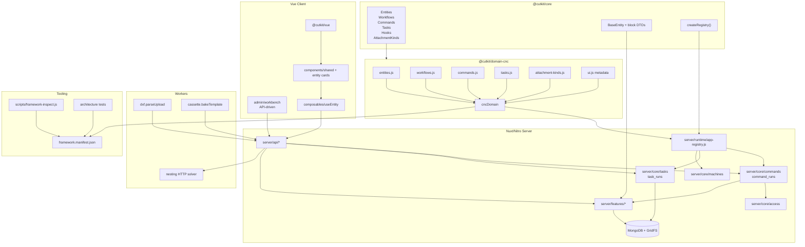
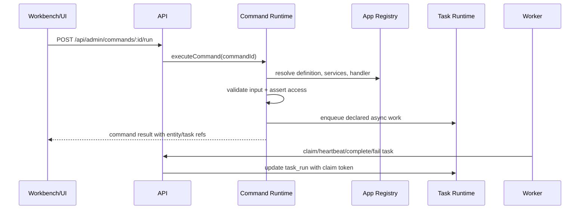

# System Architecture

This project is a modular monolith with explicit domain contracts and clean
runtime bindings. The goal is a foundation that can scale by adding domains,
features, workers, and UI surfaces without changing core vocabulary.

## Clean Boundaries

| Layer | Owns | Must Not Own |
|---|---|---|
| `@cutkit/core` | Generic vocabulary, DTOs, registries, result shapes | CNC concepts, Vue, MongoDB, workers |
| `@cutkit/domain-cnc` | CNC contracts and UI metadata | Runtime handlers, DB access, Vue components |
| `server/runtime` | Binding domain contracts to app services/handlers | Business logic |
| `server/core/commands` | Command execution/access/run history | Domain-specific imports |
| `server/core/tasks` | Async queue protocol | Worker-specific IO |
| `server/features/*` | Entity services, repositories, command handlers | Core vocabulary or global registration |
| Workbench | Contract inspection and command/task execution UI | Direct domain package imports |

## Primary Flow

Commands are business intent and access boundaries. Tasks are async execution
boundaries. Attachments are entity-linked file records; attachment kinds are
domain-declared file contracts.

## Golden Standard Checks

- `node scripts/check-arch.js`
- `npm run framework:validate`
- `npx vitest run shared/framework-packages.spec.js shared/design-system.spec.js`

## Related

- [Root README](../README.md)
- [Core](../packages/core/README.md)
- [Domain CNC](../packages/domain-cnc/README.md)
- [Runtime registry](../server/runtime/README.md)
- [Commands](../server/core/commands/README.md)
- [Tasks](../server/core/tasks/README.md)
- [Workers](../workers/README.md)
