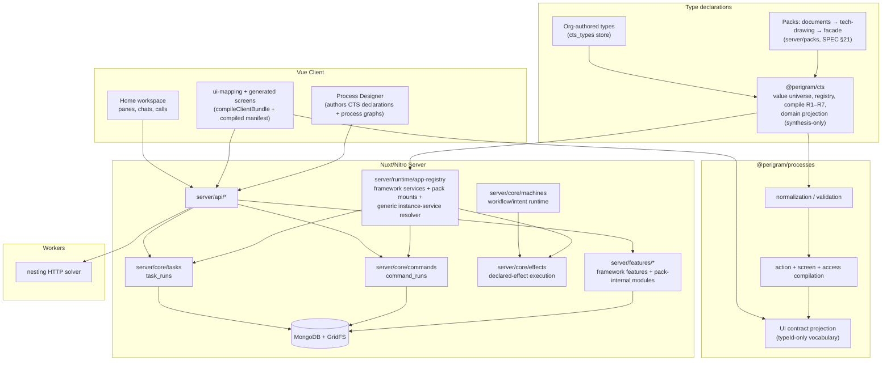
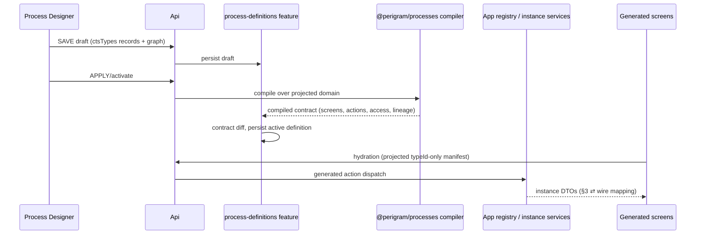

# System Architecture

Multi-tenant CNC manufacturing app built on a type-system core: domain
vocabulary is authored as CTS type declarations (packs and org-authored),
compiled by the process compiler into runtime contracts, and served by
generic instance services. The app scales by adding packs and authoring
types/processes, not by writing entity services.

## Clean Boundaries

| Layer | Owns | Must Not Own |
|---|---|---|
| `@perigram/cts` | Value universe, type declarations, registry/compile, the CTS → compiler-domain projection | Vue, Nuxt, Mongo, workers |
| `@perigram/processes` | Process normalization, validation, compilation, UI-contract projection, durable evaluation | Concrete domain imports |
| Packs (`server/packs/*`) | Domain declarations, services/commands/task executors/hook handlers as mountable units | Framework vocabulary |
| `@perigram/facade` | Facade fabrication pack declarations (cassette/sheet-design/facade-design/facade-pattern types, editors, services, commands) and the server-side domain slice | Runtime handlers, DB access, Vue components |
| `server/runtime` | Pack mounting, framework services, the instance-service resolver | Business logic |
| `server/core/*` | Command/task/effect/workflow runtimes (domain-agnostic) | Domain-specific imports |
| `server/features/*` | Framework entity services; pack-internal feature modules | Core vocabulary or global registration |
| `shared/ui-mapping` | Declaration/contract → presentation resolution (pure) | Vue/Nuxt/PrimeVue imports, CNC names |

## Primary Flow

Commands are business intent and access boundaries. Tasks are async
execution boundaries. Entity types, construction modes, workflows, and
field policy all derive from CTS declarations through the projection —
legacy hardcoded tables are pack-internal and shrink as their surfaces
are deleted (see [packages/facade/README.md](../packages/facade/README.md)
Pack direction).

## Golden Standard Checks

- `node scripts/check-arch.js`
- `npm run framework:validate`
- `npx vitest run shared/framework-packages.spec.js shared/design-system.spec.js`

## Related

- [Root README](../README.md)
- [CTS spec](../packages/cts/SPEC.md)
- [Process compiler](../packages/processes/README.md)
- [Runtime registry](../server/runtime/README.md)
- [Packs](../server/packs/README.md)
- [Commands](../server/core/commands/README.md)
- [Tasks](../server/core/tasks/README.md)
- [Workers](../workers/README.md)
