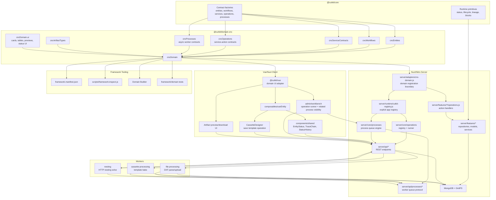
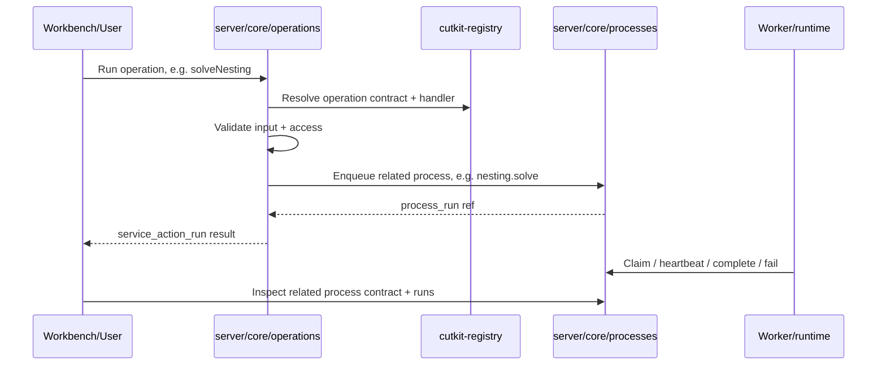

# System Architecture

This graph shows the current architecture boundary after the CNC domain refactor:
`@cutkit/core` defines reusable contracts, `@cutkit/domain-cnc` declares CNC-specific
entities and operations, and the application binds those contracts to server
features, Vue UI, workers, and Workbench tooling.

## Contract Split

- `cncOperations` are service-action contracts. They are registered by
  `server/adapters/cnc-domain.js`, implemented by feature operation handlers, and
  executed through `server/core/operations`.
- `cncProcesses` are async/worker contracts. They describe long-running work and
  are executed through the `server/core/processes` queue engine backed by
  `process_runs`.
- `server/runtime/cutkit-registry.js` creates the single app registry that binds
  domain contracts, entity services, operation handlers, and hook handlers.
- Workbench reads `/api/admin/operations` for runnable operations and
  `/api/admin/processes` for process definitions/runs. Operations remain the
  primary Workbench surface; related process contracts and spawned
  `process_runs` are shown inside the selected operation.
- Vue UI does not import server features. It consumes the domain UI adapter and
  standard entity composables/components.

## Operation And Process Flow

An operation is the business command and access boundary. A process is the async
execution and worker boundary. An operation may enqueue zero, one, or many
processes; Workbench therefore presents process state as context for the
selected operation instead of as a parallel primary workflow.

## Related Docs

- [Root system README](../README.md)
- [Domain CNC package](../packages/domain-cnc/README.md)
- [Operations runtime](../server/core/operations/README.md)
- [Processes runtime](../server/core/processes/README.md)
- [Workers](../workers/README.md)
