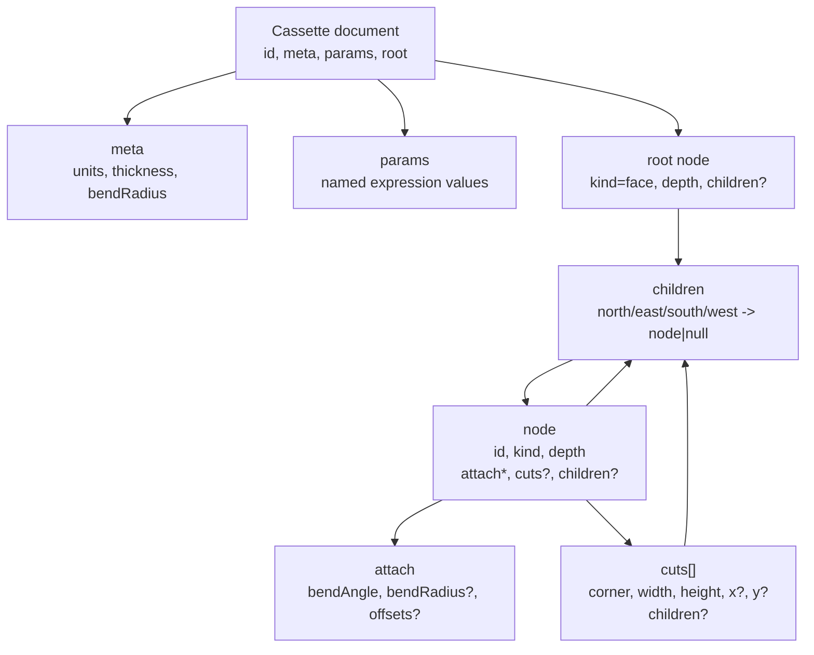

```yaml
doc_id: PERIGRAM-SPECS-CASSETTE-SCHEMA-001
classification: reference
status: active
owner: product-owner
created: 2026-01-09
updated: 2026-09-30
```

## Cassette JSON Specification v1.0

### Format Overview



`attach*` is required on every non-root node and absent on the root. `children`
is an edge-keyed recursive map; omit an edge or set it to `null` when no child is
present.

### Document Structure

```jsonc
{
  "id": <uuid>,               // required: unique document identifier
  "meta": { /* metadata */ },
  "params": { /* named dimensions */ },
  "root": { /* root face node */ }
}
```

### Meta Object

```jsonc
{
  "units": "mm",              // required: "mm" | "cm" | "in"
  "thickness": 2,             // required: sheet thickness (number or expr)
  "bendRadius": 2,            // required: default bend radius (number or expr)
}
```

### Params Object

Named dimensions. Keys are identifiers. Values are expression strings.

```jsonc
{
  "A": "600"                  // required: root face width (expr)
  "B": "400",                 // required: root face depth (expr)
  "R": "40",
  "M": "30"
}
```

### Node Structure

```jsonc
{
  "id": <uuid>,                                     // required: unique node identifier
  "kind": "face" | "return_flange" | "mount_flange",  // required
  "depth": <expr>,                                     // required
  "attach": { /* bend parameters */ },                 // absent on root only
  "cuts": [ /* cut objects */ ],                       // optional
  "children": { /* edge key -> child node */ }         // optional
}
```

### Attach Object (absent on root)

```jsonc
{
  "bendAngle": 90,                    // required: degrees, positive=out, negative=in
  "bendRadius": <expr>,               // optional: overrides meta.bendRadius
  "offsetStart": <expr>,              // optional: default "0"
  "offsetEnd": <expr>                 // optional: default "0"
}
```

- Positive `bendAngle`: bend away from parent normal (outward)
- Negative `bendAngle`: bend toward parent normal (inward)
- Offsets trim the attachment edge; both zero = full coverage

### Cut Object

```jsonc
{
  "corner": "northwest" | "northeast" | "southeast" | "southwest",  // required
  "width": <expr>,                    // required
  "height": <expr>,                   // required
  "x": <expr>,                        // optional: default "0"
  "y": <expr>,                        // optional: default "0"
  "children": { /* edge key -> flange */ }  // optional
}
```

### Children Object

Optional. Keys are edge names; values are child nodes. Omit key or set `null` for no child.

```jsonc
{
  "north": <node>,
  "east": <node>
  // south, west omitted = no children there
}
```

**Rules:**
- Non-root face: `south` cannot have children (attached to parent there)
- All node types can have children on any other edge

### Dimension Convention

- **Width** (east-west): inherited from parent edge length, or `meta.A` for root
- **Depth** (north-south): specified in `depth` field
- Root face: width = `meta.A`, depth = `depth`
- All other nodes: width = parent attachment edge length, depth = `depth`

### Expression Format

Dimension fields accept strings:
- Literal: `"600"`
- Reference: `"B"`, `"thickness"`
- Arithmetic: `"B - 2*thickness"` (operators: `+`, `-`, `*`, `/`, `()`)

### Coordinate System

- `south` edge always points toward parent
- Root face: `south` is arbitrary reference direction
- Edge keys: `north`, `east`, `south`, `west`

### Validation Rules

1. Root has no `attach`; all others must have `attach`
2. Non-root face's `children` must not have `south` key or must be `null`
3. All `kind` values: `"face"`, `"return_flange"`, `"mount_flange"`
4. Expressions reference only `params`, `meta` fields, or `thickness`, `bendRadius`
5. `bendAngle`: -180 to 180, non-zero

### Minimal Example

```json
{
  "meta": {
    "id": "123e4567-e89b-12d3-a456-426614174000",
    "units": "mm",
    "thickness": 2,
    "bendRadius": 2,
  },
  "params": {
    "A": "600"
    "B": "400",
    "R": "40",
    "M": "30"
  },
  "root": {
    "id": "223e4567-e89b-12d3-a456-426614174000",
    "kind": "face",
    "depth": "B",
    "children": {
      "north": {
        "id": "323e4567-e89b-12d3-a456-426614174000",
        "kind": "return_flange",
        "depth": "R",
        "attach": {
          "bendAngle": 90
        },
        "children": {
          "south": {
            "id": "423e4567-e89b-12d3-a456-426614174000",
            "kind": "mount_flange",
            "depth": "M",
            "attach": {
              "bendAngle": -90
            }
          }
        }
      }
    }
  }
}
```

### Corner Mitigation (Implicit)

Miter cuts computed automatically when sibling flanges meet:
- Miter angle = `(180 - |angle1| - |angle2|) / 2`
- Both 90° → 45° cuts
